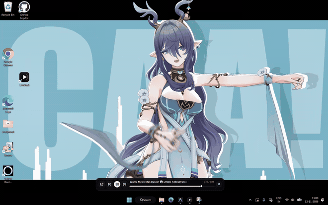
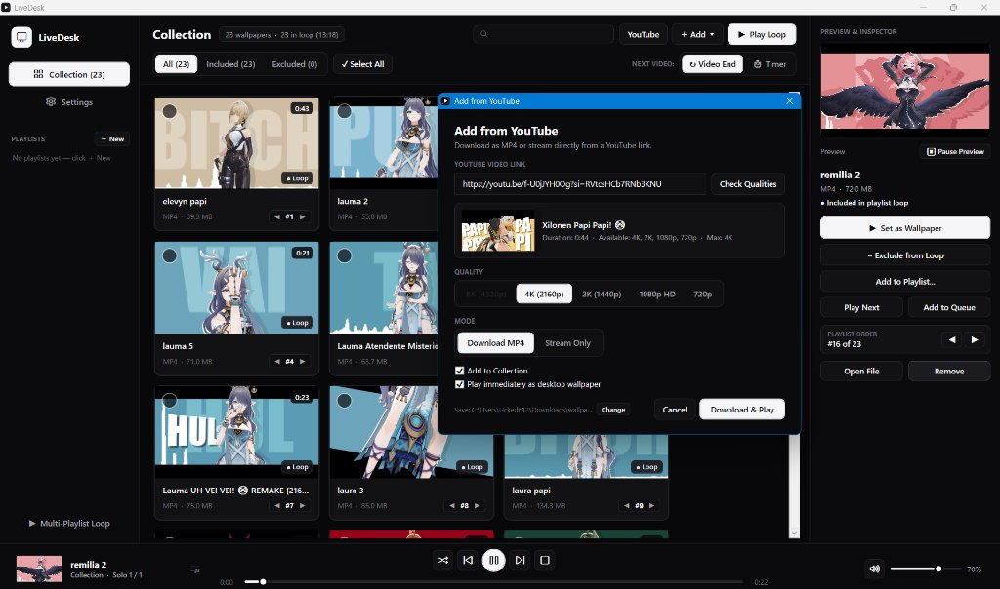
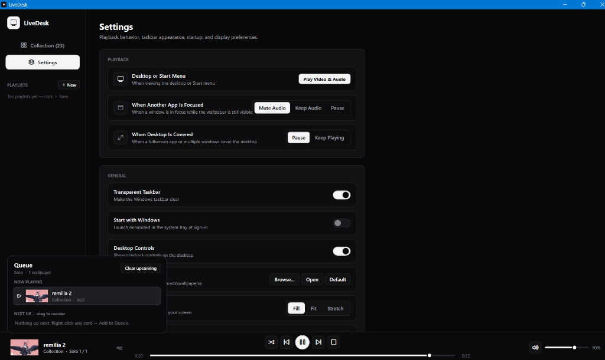
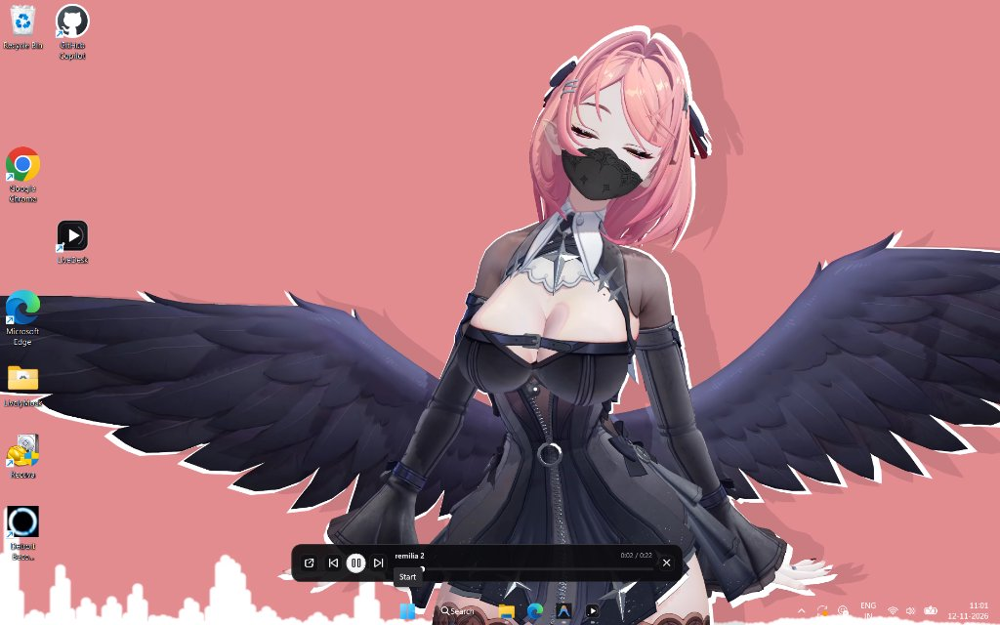

# LiveDesktop

Native live wallpaper engine for Windows 10 and Windows 11. Plays hardware-accelerated videos, animated GIFs, static images, and YouTube streams directly behind your desktop icons, with focus-aware audio rules, playlists, a drag-and-drop queue, and a built-in transparent taskbar toggle.

-0078D4?style=flat-square)

[](https://github.com/Prathamesh0612/LiveDesk/releases/download/v1.0.0/LiveDesktop_Setup.exe)

<p align="center">
  
</p>

---

## Install

Download **[`LiveDesktop_Setup.exe`](https://github.com/Prathamesh0612/LiveDesk/releases/download/v1.0.0/LiveDesktop_Setup.exe)** from [Releases](https://github.com/Prathamesh0612/LiveDesk/releases).

The installer (~106 MB) bundles everything required out of the box—application binaries, `libvlc` playback libraries, `TaskbarTap.dll`, `yt-dlp`, and `ffmpeg`—with optional Desktop shortcut and Windows startup registration.

---

## Features

- **Desktop Layer Rendering**: Attaches a borderless `libvlc` playback surface to the Windows `Progman` / `WorkerW` hierarchy behind `SHELLDLL_DefView` so desktop icons and context menus stay interactive. Supports `Fill`, `Fit`, and `Stretch` scaling.
- **Supported Formats**: `.mp4`, `.mkv`, `.avi`, `.wmv`, `.mov`, `.webm`, `.m4v`, `.mpg`, `.mpeg`, `.gif`, `.jpg`, `.jpeg`, `.png`, `.bmp`, and `.webp`.
- **Playlists & Queue**: Manage a master Collection or organize wallpapers into separate playlists with single-playlist or multi-playlist looping, end-of-video or interval transitions, **Play Next** / **Add to Queue**, and a drag-and-drop queue popover.
- **YouTube Streaming & 4K/8K Downloads**: Paste a YouTube URL to inspect available resolutions (`720p` through `4K` / `8K`), stream directly without saving locally, or download as `.mp4`. Separate DASH video/audio streams are muxed losslessly (`ffmpeg -c copy`).
- **Focus & Occlusion Rules**: Configure playback independently per desktop state:
  - *Desktop or Start Menu visible* — video & audio active.
  - *Another app focused* (windowed app in front) — `Mute Audio`, `Keep Audio`, or `Pause`.
  - *Desktop covered* (fullscreen or maximized coverage) — `Pause` or `Keep Playing`.
- **Desktop Controls HUD**: Optional compact overlay pinned to the desktop layer with seek bar, Previous / Play-Pause / Next controls, and quick window restore.
- **Transparent Taskbar**: Toggles Windows 11/10 taskbar transparency directly from Settings using a lightweight XAML visual-tree hook (`TaskbarTap.dll`) and DWM composition attributes.

---

## Screenshots

| Library, Playlists & YouTube Downloader | Settings & Queue |
| :---: | :---: |
|  |  |

<p align="center">
  
  <br>
  <sub>Active wallpaper with transparent taskbar and optional desktop playback HUD.</sub>
</p>

---

## Project Structure

```text
Desktop/
├── Program.cs         # WPF UI, WorkerW wallpaper host, VLC wrapper, queue/playlist state, YouTube pipeline
├── TaskbarTap.cpp     # Native COM IObjectWithSite / IVisualTreeServiceCallback2 taskbar transparency hook
├── TaskbarTap.def     # DLL export definitions
├── app.manifest       # DPI awareness & Windows compatibility manifest
├── app.ico            # Application icon
└── build.bat          # Compiles TaskbarTap.dll (MSVC) + LiveDesktop.exe (.NET csc.exe)
```

Runtime data, thumbnails, playlists, and downloaded tools (`yt-dlp.exe`, `ffmpeg.exe`) are stored under `%APPDATA%\LiveDesktop`.

---

## Building from Source

**Requirements**
- Windows 10 or Windows 11 (x64)
- .NET Framework 4.x (`csc.exe`, included with Windows under `C:\Windows\Microsoft.NET\Framework64\v4.0.30319`)
- Visual Studio Build Tools (only required if modifying and recompiling `TaskbarTap.cpp`)
- 64-bit VLC (`libvlc.dll`, `libvlccore.dll`, `plugins/`) placed in a `vlc\` folder next to `LiveDesktop.exe` (or VLC installed system-wide)

**Build**
```bat
cd Desktop
build.bat
```

Outputs `Desktop\LiveDesktop.exe` (and `Desktop\TaskbarTap.dll` if Visual Studio Build Tools is present).
